# Slayer Editor

A lightweight **Qt 6** code editor with a tabbed interface and an **embedded
terminal**. Write code and run it side by side — press <kbd>F5</kbd> to compile
and run the current file, with language-server diagnostics, a visual debugger,
a Kate-style split view and a choice of themes.

This is the Linux port of the Android Slayer Editor.

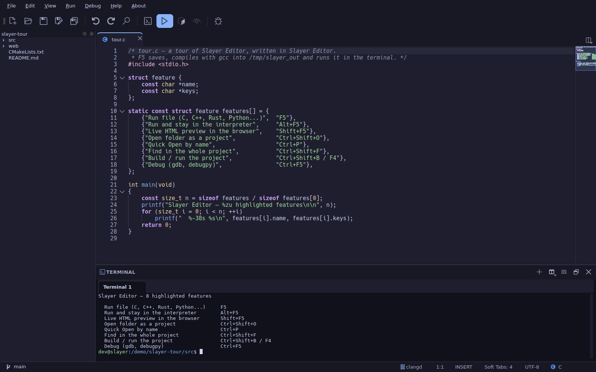

## Features

- **Tabbed editor** with syntax highlighting, auto-indentation, auto-closing
  pairs, find/replace with history, code folding and a minimap.
- **Embedded terminal** (QTermWidget) with tabs, dockable on any edge of the
  window or detached, with a Konsole-like context menu (color scheme, cursor,
  history, scrollbar) and search.
- **Run with <kbd>F5</kbd>** — C, C++, Python, Rust, Go, JavaScript, Java and
  shell scripts, straight into the built-in terminal. <kbd>Alt</kbd>+<kbd>F5</kbd>
  runs and stays in the interpreter (Python, JavaScript, shell).
- **Projects** — open a folder (<kbd>Ctrl</kbd>+<kbd>Shift</kbd>+<kbd>O</kbd>)
  to get a file tree, Quick Open (<kbd>Ctrl</kbd>+<kbd>P</kbd>), Find in
  Project (<kbd>Ctrl</kbd>+<kbd>Shift</kbd>+<kbd>F</kbd>) and per-project
  sessions. Build (<kbd>Ctrl</kbd>+<kbd>Shift</kbd>+<kbd>B</kbd>) and run
  (<kbd>F4</kbd>) the whole project, with CMake, Make, Cargo, Go, npm, Meson
  and Python detected automatically.
- **Live HTML preview** (<kbd>Shift</kbd>+<kbd>F5</kbd>) — the page reloads in
  the browser as you type, with a built-in or external server.
- **Language Server Protocol** — diagnostics and completion (clangd, pylsp,
  rust-analyzer, gopls, typescript-language-server, and more), configurable per
  language.
- **Visual debugger** over the Debug Adapter Protocol — breakpoints, stepping,
  variables and the call stack (`gdb` for C/C++, `debugpy` for Python).
- **Kate-style split view** — one document across several panes — and a status
  bar with git branch, cursor position, encoding and more.
- **Large files** — a performance mode (automatic or always on) that turns off
  the expensive features for huge or minified files.
- **Themes** — dozens of light and dark color schemes that can follow the
  system; create and edit your own in the theme editor, including the
  selection, matching-bracket/tag and occurrence **highlight** colors (with
  adjustable opacity). Plus an optional symbol display.
- **Built-in help** (<kbd>F1</kbd>) with search and a shortcut table, and an
  English / Brazilian Portuguese interface.

## Screenshots

The code in every screenshot describes the editor itself.

| | |
|---|---|
| 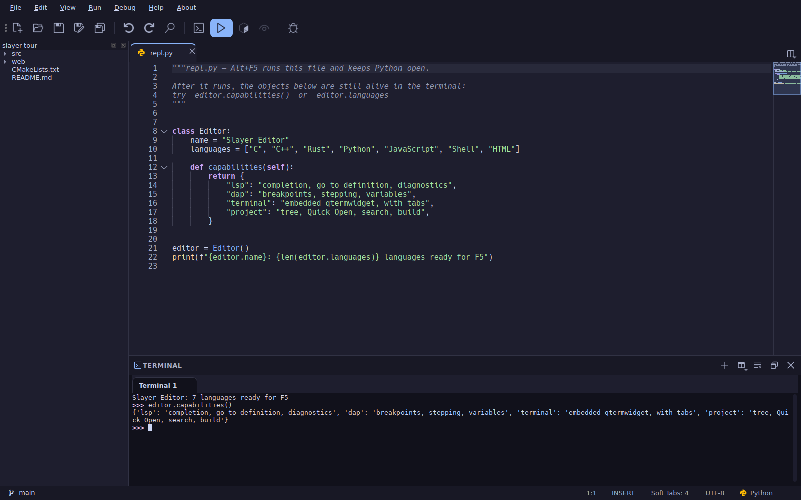 <br> **Interactive run** (<kbd>Alt</kbd>+<kbd>F5</kbd>) | 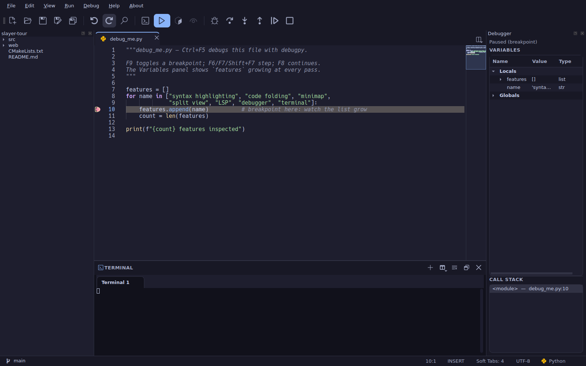 <br> **Debugger** — breakpoints, variables, call stack |
| 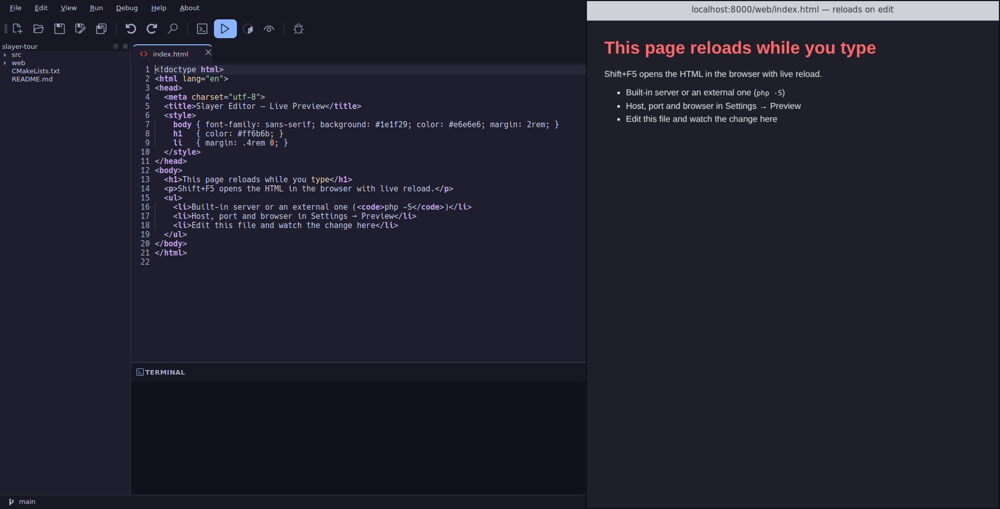 <br> **Live HTML preview** (<kbd>Shift</kbd>+<kbd>F5</kbd>) |  <br> **Project** — build and run (<kbd>F4</kbd>) |
| 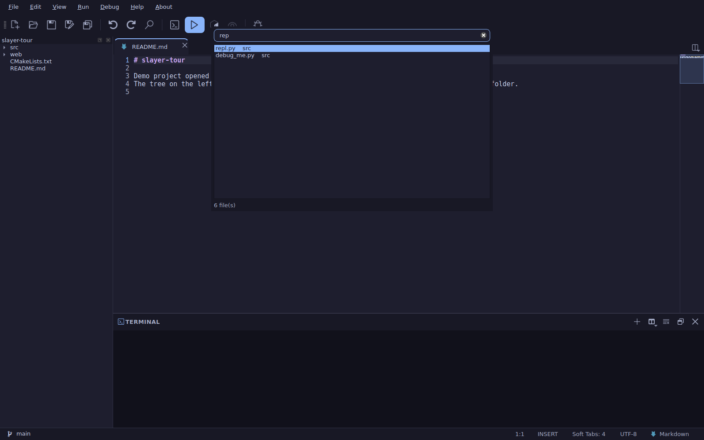 <br> **Quick Open** (<kbd>Ctrl</kbd>+<kbd>P</kbd>) | 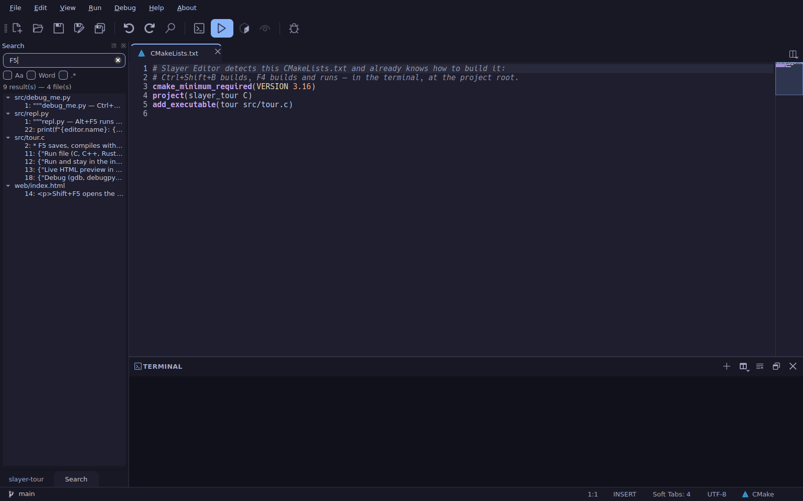 <br> **Find in Project** (<kbd>Ctrl</kbd>+<kbd>Shift</kbd>+<kbd>F</kbd>) |
| 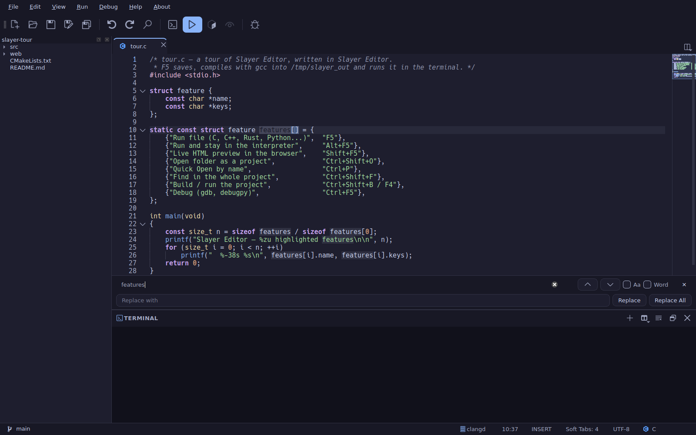 <br> **Find and replace** (<kbd>Ctrl</kbd>+<kbd>H</kbd>) | 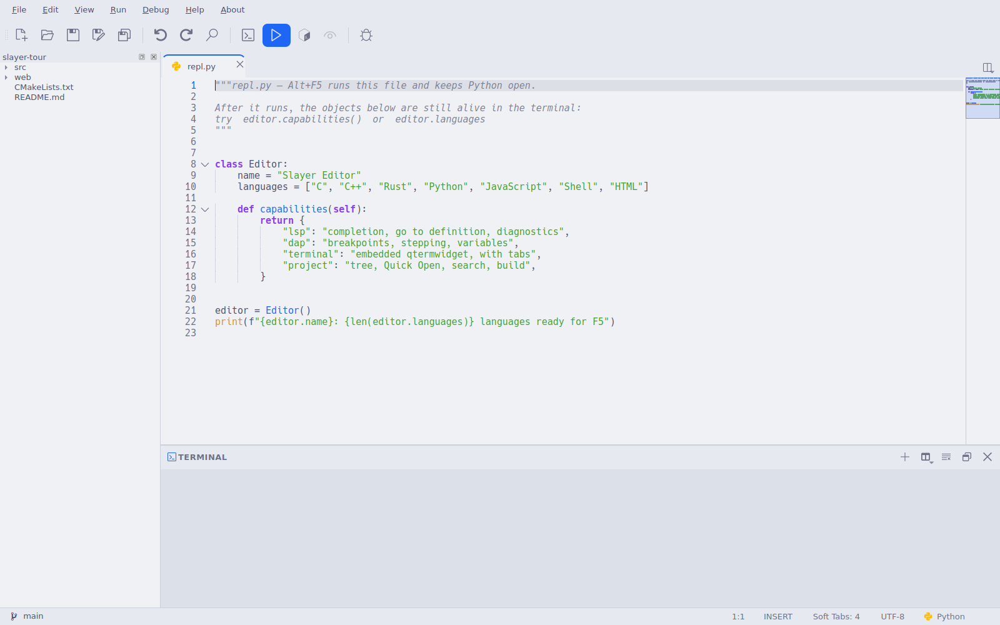 <br> **Light theme** (<kbd>Ctrl</kbd>+<kbd>Shift</kbd>+<kbd>D</kbd>) |
| 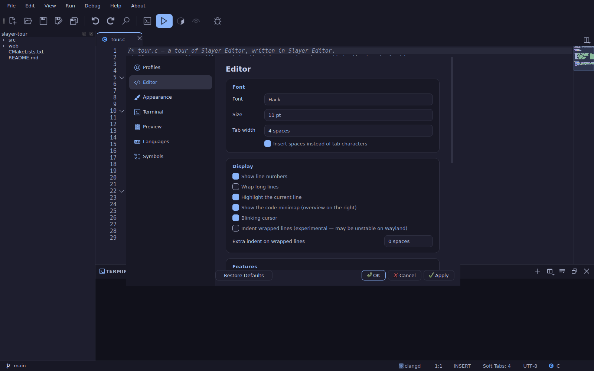 <br> **Settings — Editor** (<kbd>Ctrl</kbd>+<kbd>,</kbd>) | 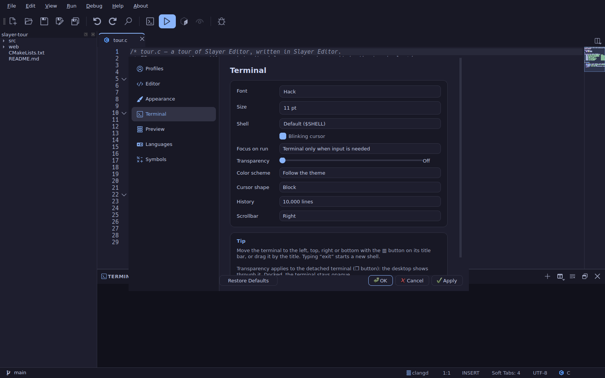 <br> **Settings — Terminal** |
| 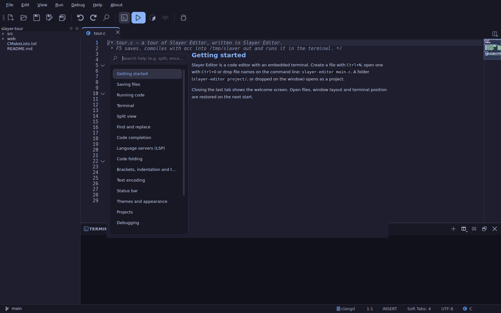 <br> **Built-in help** (<kbd>F1</kbd>) | |

## Install

### Debian / Ubuntu (amd64)

The prebuilt packages below target **Debian 13 (trixie)** and newer (and recent
Ubuntu releases), and need the **Qt 6 (6.8+)** they were built against. Pick one
of the options below. (Building from source needs only **Qt 6 ≥ 6.4** — see
[Build from source](#build-from-source).)

#### Option 1 — APT repository via `extrepo` (recommended)

[`extrepo`](https://salsa.debian.org/extrepo-team/extrepo) adds the signed
repository and its key for you, and `apt` keeps the editor up to date:

```bash
sudo apt install extrepo
sudo extrepo enable slayer-editor
sudo apt update
sudo apt install slayer-editor
```

> The `extrepo` entry is tracked at
> <https://salsa.debian.org/extrepo-team/extrepo-data/-/merge_requests/585>.

#### Option 2 — APT repository, manual

Add the signed APT repository at <https://wyllianbs.github.io/slayer-apt/> — this
also keeps the editor updated with `apt`:

```bash
# 1. Add the signing key
curl -fsSL https://wyllianbs.github.io/slayer-apt/slayer-editor.gpg.asc \
  | sudo gpg --dearmor -o /usr/share/keyrings/slayer-editor.gpg

# 2. Add the repository
echo "deb [signed-by=/usr/share/keyrings/slayer-editor.gpg] https://wyllianbs.github.io/slayer-apt stable main" \
  | sudo tee /etc/apt/sources.list.d/slayer-editor.list

# 3. Install
sudo apt update
sudo apt install slayer-editor
```

Update, uninstall and key-verification details are in the
[slayer-apt](https://github.com/wyllianbs/slayer-apt) repository.

#### Option 3 — Download the latest `.deb`

A one-off install of the newest release (no repository, no automatic updates):

```bash
sudo apt update && sudo apt install -y curl wget

wget -O /tmp/slayer-editor.deb \
  "$(curl -s https://api.github.com/repos/wyllianbs/SE/releases/latest \
  | grep browser_download_url \
  | grep 'amd64.deb' \
  | cut -d '"' -f 4)"

sudo apt install /tmp/slayer-editor.deb
```

Or download it by hand from the [Releases](https://github.com/wyllianbs/SE/releases)
page and run `sudo apt install ./slayer-editor_*_amd64.deb`.

To run programs from the editor, install the relevant toolchains (for example
`build-essential` and `python3`). Language servers and debuggers are optional
and detected automatically when present (`clangd`, `pylsp`, `gdb`, `debugpy`, …).

## Build from source

Requires **Qt 6 ≥ 6.4**. Build dependencies:

```bash
sudo apt install cmake qt6-base-dev libqtermwidget-dev qt6-l10n-tools libutf8proc-dev
```

Configure, build and run:

```bash
cmake -B build -DCMAKE_BUILD_TYPE=Release
cmake --build build
./build/slayer-editor
```

To build the Debian package instead:

```bash
dpkg-buildpackage -us -uc -b
```

## License

Slayer Editor is released under the **GPL-3.0-or-later** license; see
[LICENSE](LICENSE). The bundled fonts (Hack, JetBrains Mono and Nerd Fonts
symbols) keep their own licenses, documented in
[debian/copyright](debian/copyright).

Copyright © Wyllian Bezerra da Silva
