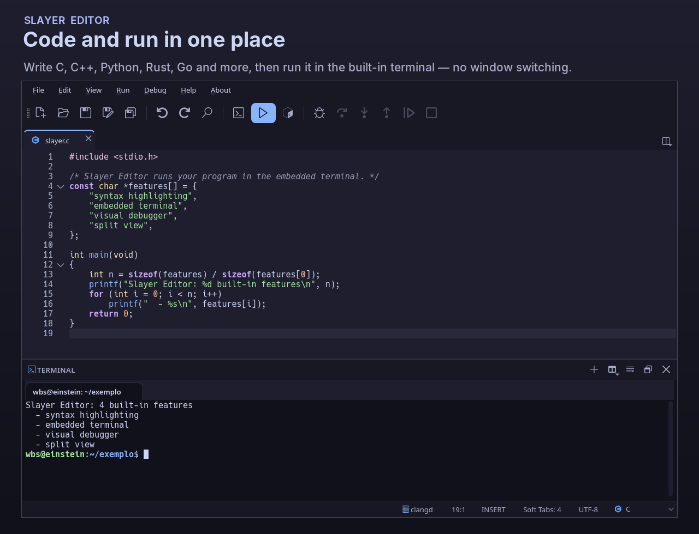

# Slayer Editor

A lightweight **Qt 6** code editor with a tabbed interface and an **embedded
terminal**. Write code and run it side by side — press <kbd>F5</kbd> to compile
and run the current file, with language-server diagnostics, a visual debugger,
a Kate-style split view and a choice of themes.

This is the Linux port of the Android Slayer Editor.



## Features

- **Tabbed editor** with syntax highlighting, auto-indentation, auto-closing
  pairs, find/replace and code folding.
- **Embedded terminal** (QTermWidget) dockable on any edge of the window, or
  detached.
- **Run with <kbd>F5</kbd>** — C, C++, Python, Rust, Go, JavaScript, Java and
  shell scripts, straight into the built-in terminal.
- **Language Server Protocol** — diagnostics and completion (clangd, pylsp,
  rust-analyzer, gopls, typescript-language-server, and more), configurable per
  language.
- **Visual debugger** over the Debug Adapter Protocol — breakpoints, stepping,
  variables and the call stack (`gdb` for C/C++, `debugpy` for Python).
- **Kate-style split view** — one document across several panes — and a status
  bar with git branch, cursor position, encoding and more.
- **Themes** — dozens of light and dark color schemes that can follow the
  system, plus an optional symbol display.

## Install

### Debian / Ubuntu (amd64)

Slayer Editor needs **Qt 6 ≥ 6.8.2**, available on Debian 13 (trixie) and newer,
and on recent Ubuntu releases. Pick one of the options below.

#### Option 1 — APT repository via `extrepo` (recommended)

[`extrepo`](https://salsa.debian.org/extrepo-team/extrepo) adds the signed
repository and its key for you, and `apt` keeps the editor up to date:

```bash
sudo apt install extrepo
sudo extrepo enable slayer-editor
sudo apt update
sudo apt install slayer-editor
```

> The `extrepo` entry is under review:
> <https://salsa.debian.org/extrepo-team/extrepo-data/-/merge_requests/585>
> Until it is accepted, use Option 2.

#### Option 2 — APT repository, manual

Add the signed APT repository at <https://wyllianbs.github.io/slayer-apt/> — this
also keeps the editor updated with `apt`:

```bash
# 1. Add the signing key
curl -fsSL https://wyllianbs.github.io/slayer-apt/slayer-editor.gpg.asc \
  | sudo gpg --dearmor -o /usr/share/keyrings/slayer-editor.gpg

# 2. Add the repository
echo "deb [signed-by=/usr/share/keyrings/slayer-editor.gpg] https://wyllianbs.github.io/slayer-apt stable main" \
  | sudo tee /etc/apt/sources.list.d/slayer-editor.list

# 3. Install
sudo apt update
sudo apt install slayer-editor
```

Update, uninstall and key-verification details are in the
[slayer-apt](https://github.com/wyllianbs/slayer-apt) repository.

#### Option 3 — Download the latest `.deb`

A one-off install of the newest release (no repository, no automatic updates):

```bash
sudo apt update && sudo apt install -y curl wget

wget -O /tmp/slayer-editor.deb \
  "$(curl -s https://api.github.com/repos/wyllianbs/SE/releases/latest \
  | grep browser_download_url \
  | grep 'amd64.deb' \
  | cut -d '"' -f 4)"

sudo apt install /tmp/slayer-editor.deb
```

Or download it by hand from the [Releases](https://github.com/wyllianbs/SE/releases)
page and run `sudo apt install ./slayer-editor_*_amd64.deb`.

To run programs from the editor, install the relevant toolchains (for example
`build-essential` and `python3`). Language servers and debuggers are optional
and detected automatically when present (`clangd`, `pylsp`, `gdb`, `debugpy`, …).

## Build from source

Build dependencies:

```bash
sudo apt install cmake qt6-base-dev libqtermwidget-dev qt6-l10n-tools libutf8proc-dev
```

Configure, build and run:

```bash
cmake -B build -DCMAKE_BUILD_TYPE=Release
cmake --build build
./build/slayer-editor
```

To build the Debian package instead:

```bash
dpkg-buildpackage -us -uc -b
```

## License

Slayer Editor is released under the **GPL-3.0-or-later** license; see
[LICENSE](LICENSE). The bundled fonts (Hack, JetBrains Mono and Nerd Fonts
symbols) keep their own licenses, documented in
[debian/copyright](debian/copyright).

Copyright © Wyllian Bezerra da Silva
